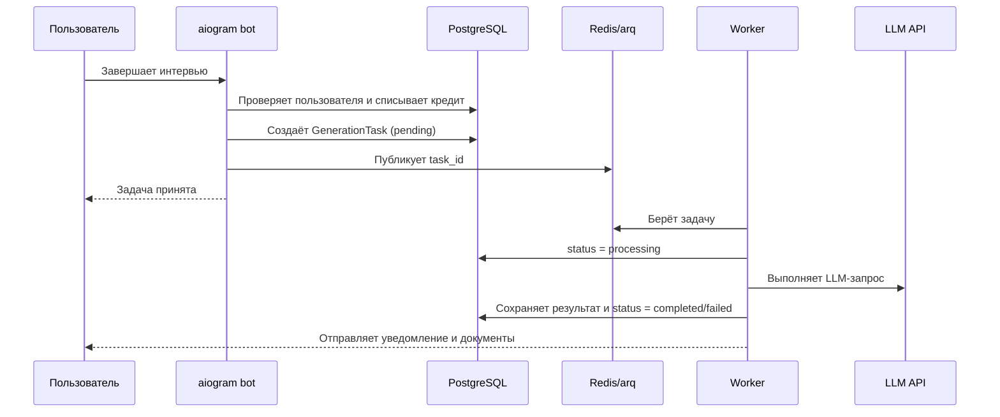

# 📋 Terms Of Reference — with GPT

> Telegram-бот, который помогает заказчику описать идею IT-продукта и получить основу технического задания (ТЗ).

Бот проводит короткое интервью: задаёт вопросы по одному, собирает ответы и передаёт их языковой модели. Готовый документ отправляется в Telegram в форматах **DOCX** и **PDF**.

## ✨ Возможности

- 💬 Диалог с пользователем через Telegram
- 🧭 Сбор требований по этапам с помощью FSM aiogram
- 🤖 Подключение к OpenAI-совместимому API языковой модели
- 📝 Формирование технического задания на русском языке
- 📄 Экспорт результата в DOCX и PDF
- ⚙️ Настройка токенов, модели и адреса API через `.env`

## 🧰 Технологии

| Технология | Назначение |
| --- | --- |
| **Python 3.11+** | Язык приложения |
| **aiogram 3** | Telegram Bot API, маршрутизация и FSM |
| **OpenAI Python SDK** | Асинхронные запросы к OpenAI-совместимому API |
| **Pydantic Settings** | Загрузка и проверка настроек из окружения |
| **python-dotenv** | Чтение настроек из файла `.env` |
| **python-docx** | Создание документа DOCX |
| **fpdf2** | Создание PDF-документа |

## 🚀 Быстрый запуск

### 1. Подготовьте окружение

```bash
git clone https://github.com/HellenWeb/termsOfReference-llm.git
cd termsOfReference-llm
python3 -m venv .venv
source .venv/bin/activate
python -m pip install -r requirements.txt
```

В Windows активируйте окружение командой `.venv\Scripts\activate`.

### 2. Настройте переменные окружения

Скопируйте пример настроек и заполните значения:

```bash
cp .env.example .env
```

| Переменная | Описание |
| --- | --- |
| `BOT_TOKEN` | Токен Telegram-бота, созданного через [@BotFather](https://t.me/BotFather) |
| `LLM_API_KEY` | API-ключ выбранного LLM-провайдера |
| `LLM_BASE_URL` | Базовый URL OpenAI-совместимого API |
| `LLM_MODEL` | Идентификатор модели провайдера |
| `LOG_LEVEL` | Уровень логирования, например `INFO` или `DEBUG` |
| `ENVIRONMENT` | Название окружения, например `development` |

Не публикуйте `.env` и не добавляйте реальные ключи в репозиторий.

### 3. Запустите бота

```bash
python -m bot.main
```

## 👤 Как пользоваться

1. Откройте бота в Telegram и отправьте `/start`.
2. Нажмите кнопку начала интервью.
3. Отвечайте на вопросы о проекте: его целях, аудитории, функциях и ограничениях.
4. Когда интервью завершится, получите ТЗ в DOCX и PDF.

## 🗂️ Структура проекта

```text
bot/
├── handlers/       # Команды и обработчики диалога
├── keyboards/      # Клавиатуры Telegram
├── services/       # LLM-клиент и генерация ТЗ
├── states/         # Состояния FSM интервью
├── utils/          # Общие утилиты, включая логирование
├── config.py       # Настройки приложения
└── main.py         # Точка входа и запуск polling
tests/              # Тесты проекта
```

## 🏗️ Масштабируемая архитектура

Проект постепенно разделяется на четыре слоя:

- **Presentation** — aiogram routers, FSM, клавиатуры и Telegram-ответы.
- **Application** — сценарии `CreditService` и `GenerationService`; здесь нет SQL или Redis-кода.
- **Domain** — статусы, контракты портов и модели предметной области.
- **Infrastructure** — SQLAlchemy/PostgreSQL, Redis, arq, платежный провайдер и LLM-адаптеры.

Новые заготовки находятся в `bot/domain/`, `bot/application/`, `bot/infrastructure/` и `bot/workers/`.

### Поток генерации



### Почему PostgreSQL + Redis + arq

- **PostgreSQL + SQLAlchemy 2 async** — транзакции, история кредитов, платежей и генераций.
- **Redis** — распределённое FSM-хранилище и быстрый брокер фоновых задач.
- **arq** — лёгкая asyncio-очередь, естественно сочетающаяся с aiogram и async SQLAlchemy.
- **ЮKassa** — основной платёжный адаптер для РФ; интерфейс `PaymentProvider` оставляет возможность добавить Telegram Payments или Stripe.

Worker запускается отдельно:

```bash
python -m bot.workers.run
```

Текущие `GenerationTask` и `YooKassaProvider` намеренно являются скелетом: списание, webhook-проверка, генерация документов и уведомления должны быть реализованы отдельными этапами.

## 🛣️ Roadmap

1. Подключить PostgreSQL, Alembic и миграции; реализовать регистрацию пользователя.
2. Завершить атомарные операции кредитов и историю транзакций.
3. Перенести FSM с Redis в production-конфигурацию и вынести worker в отдельный процесс.
4. Реализовать `GenerationTask`: статусы, retry, идемпотентность и хранение результатов.
5. Добавить объектное хранилище для DOCX/PDF и уведомления пользователя.
6. Подключить ЮKassa, webhook и выдачу кредитов после подтверждённой оплаты.
7. Добавить личный кабинет, мониторинг, метрики, rate limits и горизонтальное масштабирование.

## ⚠️ Примечания

- Для работы нужны действующие Telegram Bot Token и API-ключ LLM-провайдера.
- Для генерации PDF используется Unicode-шрифт, поддерживающий кириллицу (например, DejaVu Sans или Arial).
- FSM использует хранилище в памяти: при перезапуске бота незавершённые диалоги не сохраняются.
